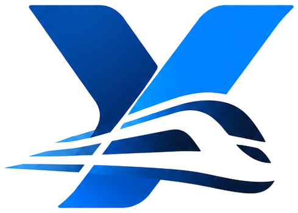
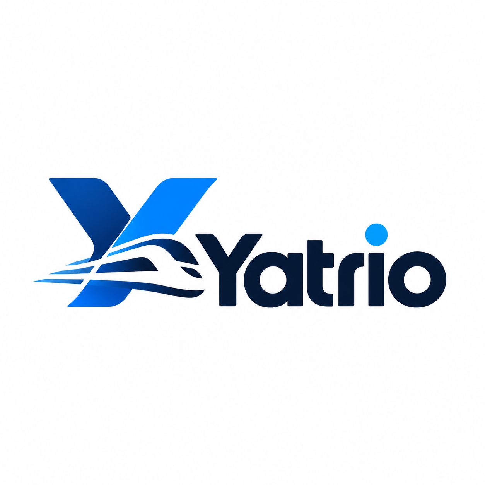

<div align="center">


### Move Beyond Limits

*A MERN railway booking demo — live train search, PNR status, live tracking, and a full demo booking flow with Razorpay test payments.*

<br>


<br>

**[Architecture](#-architecture) · [Features](#-features) · [User Flow](#-user-flow) · [API Map](#-api-map) · [Pages](#-frontend-pages) · [Data](#-data-architecture) · [Brand](#-brand-kit)**

</div>

<br>

## 🚄 About

Yatrio puts every trip in the traveler's hand — live trains, honest timings, and booking that feels as fast as the train itself. Rail journeys, reimagined in motion.

This repository is the **Yatrio MERN Railway Booking Demo**. It connects to an **IRCTC / authorised Railway API** for real search and status data, but all payments run in **Razorpay TEST MODE** and every booking, PNR, and ticket is a **demo artifact** — **no real IRCTC ticket booking is performed**.

<div align="center">
  
  <p><sub>Primary lockup — "Move Beyond Limits"</sub></p>
</div>

<br>

## 🏗 Architecture

```
┌────────────────────────────┐
│      YATRIO FRONTEND       │
│    React + Vite + Tailwind │
└─────────────┬──────────────┘
              │  HTTPS / REST
┌─────────────▼──────────────┐
│       YATRIO BACKEND       │
│    Node.js + Express.js    │
│                            │
│  Auth · Train Search ·     │
│  Live Status · Booking ·   │
│  Payment · Trips           │
└──────┬───────────┬─────────┘
       │           │
       ▼           ▼
┌────────────┐  ┌──────────────┐  ┌─────────────────┐
│  IRCTC /   │  │   Razorpay   │  │   MongoDB /     │
│ Railway API│  │  TEST MODE   │  │     MySQL       │
│            │  │              │  │                 │
│ • Search   │  │ • Demo Order │  │ • Users         │
│ • Avail.   │  │ • Test Pay   │  │ • Passengers    │
│ • Live     │  │ • Verify     │  │ • Bookings      │
│  Status    │  │              │  │ • Searches      │
└────────────┘  └──────────────┘  └─────────────────┘
```

### Application Modules

| Module | Responsibilities |
| --- | --- |
| **Auth** | Login, Register, Sessions |
| **Railway** | Search, Availability, Schedule, Live Status, PNR |
| **Booking** | Passenger, Fare, Booking, Ticket |
| **Payment** | Razorpay test-mode orders, verification |
| **Optional** | Confirmation Prediction, Alternative Routes / Trains |

<div align="center">
  
</div>

<br>

## ✨ Features

- 🔍 **Train Search** — from / to / date search with trains, times, classes, availability, and fares
- 📍 **Live Train Status** — current station, delay, and ETA by train number
- 🎫 **PNR Status** — check reservation status by PNR
- 🧾 **Demo Booking** — passenger details → fare summary → demo ticket with a demo PNR
- 💳 **Razorpay Test Payments** — order creation, test checkout, and signature verification
- 🗂 **My Trips** — all bookings and tickets in one place
- 🔮 **Optional modules** — confirmation prediction ("78% Confirmation") and alternative train / route suggestions

<br>

## 🧭 User Flow

```
HOME
 ├── BOOK TRAIN ──── From / To / Date ──► SEARCH TRAINS
 ├── PNR STATUS ──── Enter PNR ─────────► PNR Result
 └── LIVE STATUS ─── Train Number ──────► Live Location
              │
              ▼
      TRAIN RESULTS  (train · time · classes · availability · fare)
              ▼
      SELECT TRAIN
              ▼
      PASSENGER DETAILS
              ▼
      FARE SUMMARY
              ▼
      RAZORPAY TEST PAYMENT ──── FAILED ──► RETRY
              │ SUCCESS
              ▼
      DEMO BOOKING ──► DEMO PNR ──► DEMO TICKET ──► MY TRIPS
```

### Train Search Flow

```
React → Search Form → GET /api/trains/search → Express Controller
      → Railway API Service → IRCTC / Authorised Railway API
      → Normalize Response → React Train Results
```

### Live Train Location Flow

```
React → Train Number → GET /api/trains/:trainNo/status → Express
      → Railway API Service → IRCTC / Railway Live Status API
      → Current Station + Delay + ETA → React Live Tracking UI
```

> ⚡ An **optional Redis cache** can hold the latest live status with a TTL.

### Demo Payment + Booking Flow

```
Passenger Details → Create Booking (PENDING) → Create Razorpay TEST Order
     → Razorpay TEST CHECKOUT ── FAIL ──► RETRY
                    │ SUCCESS
                    ▼
          Verify Payment → Mark PAID → Create DEMO Booking
                    → Generate DEMO PNR / Ticket
```

> ⚠️ **No real IRCTC booking** is ever made — this is a demo pipeline end to end.

<br>

## 🔮 Optional Modules

### Confirmation Prediction

Consumes train / availability data — WL / RAC position, class, quota, days remaining, and (optionally) historical data — to return an **estimated probability**, e.g. *"78% Confirmation"*.

### Alternative Trains / Routes

Given a selected journey, an alternative engine proposes same-route / different-train, nearby-station, different-class, or different-route options, then **filters and ranks** them into suggestions.

<br>

## 🗺 API Map

| Module | Endpoint | Method |
| --- | --- | --- |
| **Auth** | `/api/auth/register` | `POST` |
| | `/api/auth/login` | `POST` |
| **Trains** | `/api/trains/search` | `GET` |
| | `/api/trains/:id` | `GET` |
| | `/api/trains/:id/availability` | `GET` |
| | `/api/trains/:id/schedule` | `GET` |
| | `/api/trains/:id/status` | `GET` |
| **PNR** | `/api/pnr/:pnr` | `GET` |
| **Booking** | `/api/bookings` | `POST` |
| | `/api/bookings` | `GET` |
| | `/api/bookings/:id` | `GET` |
| | `/api/bookings/:id/cancel` | `POST` |
| **Payment** | `/api/payments/order` | `POST` |
| | `/api/payments/verify` | `POST` |
| **Optional** | `/api/prediction` | `POST` |
| | `/api/alternatives` | `POST` |

<br>

## 🖥 Frontend Pages

| Route | Page |
| --- | --- |
| `/` | Home |
| `/search` | Train Search |
| `/trains` | Train Results |
| `/trains/:id` | Train Details |
| `/booking` | Passenger + Checkout |
| `/booking/success` | Demo Ticket |
| `/trips` | My Trips |
| `/trips/:id` | Ticket Details |
| `/pnr` | PNR Status |
| `/live-status` | Live Train Status |
| `/login` | Authentication |
| `/prediction` *(optional)* | Confirmation Prediction |
| `/alternatives` *(optional)* | Alternative Suggestions |

<br>

## 💾 Data Architecture

Three persistence options — **choose ONE primary DB**:

| Database | Collections / Tables | Notes |
| --- | --- | --- |
| **MongoDB** ✅ | Users, Passengers, Trips | Recommended for MERN — **MongoDB + Mongoose** |
| **MySQL** | Users, Bookings, Payments, Searches | If relational is preferred — **Prisma / Sequelize** |
| **Redis** *(optional)* | API cache, Live status | Latest live status + TTL |

<br>

## 🎯 MVP Boundary

| ✅ Real | 🧪 Demo | 🔮 Optional |
| --- | --- | --- |
| Train Search | Razorpay TEST | Prediction |
| Live Status | Demo Booking | Alternatives |
| Schedule | Demo PNR | Alternate Routes |
| Availability | Demo Ticket | |

**Real data source:** IRCTC / Authorised Railway API · **Never:** real ticket booking

<br>

<div align="center">

## 🎨 Brand Kit

<kbd></kbd>
&nbsp;
<kbd></kbd>
&nbsp;
<kbd></kbd>
&nbsp;
<kbd></kbd>

*Logo variants — original · azure · navy mono · white mono*

**Primary Palette** — `#04275B` Navy · `#014CA9` Royal Blue · `#0080F8` Azure · `#3BB3FD` Sky · `#F7F9FC` Paper

**Typography** — Poppins Bold for display · Poppins Regular for body · Inter for UI

The Poppins webfonts (400 / 500 / 600 / 700) and all logo assets live in [`brandkit/assets/`](brandkit/assets). The full identity system — five brand boards with logo construction, color system, typography, and digital / physical applications — lives in [`brandkit/`](brandkit).

</div>

---

<div align="center">
  <sub><a href="#"></a></sub>
  <br><br>
  <sub>Yatrio — Architecture v1 · MERN + Railway API + Razorpay Test Mode</sub>
  <br>
  <sub><i>Move Beyond Limits 🚄</i></sub>
</div>
