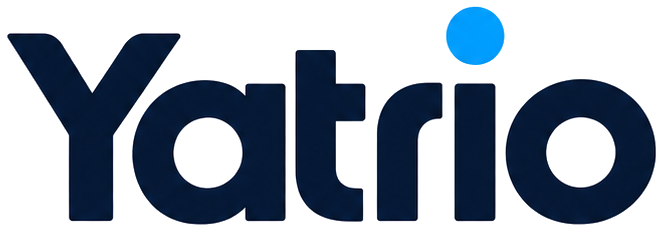

# Yatrio — Brand Kit & Frontend System

> **Single source of truth for building Yatrio frontend pages.**
> Every value in this document is derived from the existing brand assets in
> [`brandkit/`](brandkit/) and is already (or is meant to be) wired into
> [`Frontend/src/index.css`](Frontend/src/index.css).
> If a rule here and a page disagree, the rule wins.

**Brand essence** — Rail journeys, reimagined in motion.
**Tagline** — Move Beyond Limits.
**Voice** — precise, calm, engineered. The product feels as fast as the train.

---

## Table of contents

| § | Section | Purpose |
|---|---|---|
| [0](#0-how-to-use-this-document) | How to use this document | Reading order + authority rules |
| [1](#1-source-of-truth--file-map) | Source of truth & file map | Which file wins |
| [2](#2-foundation--token-wiring) | Foundation: token wiring | The only CSS you need to add |
| [3](#3-color-system) | Color system | Palette, semantics, verified contrast |
| [4](#4-typography) | Typography | Families, scale, tracking rules |
| [5](#5-logo--imagery) | Logo & imagery | Asset map, clearspace, misuse |
| [6](#6-layout--spacing--motion) | Layout, spacing, motion | Grid, radii, elevation, motion |
| [7](#7-component-specifications) | Component specifications | Copy-paste class strings |
| [8](#8-iconography) | Iconography | Stroke rules, sprite usage |
| [9](#9-page-blueprints) | Page blueprints | All 13 routes |
| [10](#10-frontend-structure--conventions) | Structure & conventions | File layout, component API |
| [11](#11-copy--voice) | Copy & voice | Writing rules |
| [12](#12-accessibility-requirements) | Accessibility | Non-negotiables |
| [13](#13-definition-of-done) | Definition of Done | Pre-merge checklist |
| [14](#14-anti-patterns-never) | Anti-patterns | Never do this |
| [A](#appendix-a--token-quick-reference) | Appendix A | Copy-paste CSS |
| [B](#appendix-b--verified-contrast-tables) | Appendix B | Measured ratios |

---

## 0. How to use this document

**Read once, top to bottom.** Sections 1–6 are the foundation. Sections 7–9 are the
working reference — jump to them while building.

**Authority order** (highest first):

1. This document
2. `brandkit/` — the five brand boards + `shared.css`
3. `brandkit/assets/` — logo and font binaries
4. `README.md` — brand summary section
5. Existing page code — if a page contradicts the brand, the page is wrong

**Hard rules:**

- Never introduce a colour, font, radius, or shadow that is not defined here.
- Never add a dependency (icon library, UI kit, font CDN) to solve something this
  document already solves.
- Every new page must use the components in §7 — do not re-derive them inline.
- If you must deviate, deviate in exactly one place: add a token to
  `Frontend/src/index.css` and note it in the PR description.

---

## 1. Source of truth & file map

### 1.1 Brand boards (`brandkit/`)

These are 1920×1080 presentation boards. They define the system.

| File | Defines | Use it for |
|---|---|---|
| `brandkit/board1-overview.html` | Brand essence, logo construction, digital + physical application, image direction, UI chips, stat tiles | Overall feel, hero art direction, status chip anatomy |
| `brandkit/board2-logo.html` | Primary lockup, stacked lockup, monogram, clearspace, min sizes, misuse list | Every logo placement decision |
| `brandkit/board3-color.html` | Full palette, 3 signature gradients, 60/25/10/5 proportion, contrast scores, application rules | Every colour decision |
| `brandkit/board4-typography.html` | Display specimen, 4 weights, type scale, hierarchy in product, Poppins/Inter pairing, DO/DON'T | Every type decision |
| `brandkit/board5-applications.html` | App icons, web hero, ticket, wayfinding, brand pattern, stationery, badge, motion endcard | Real-world layout references |
| `brandkit/shared.css` | The canonical token values + blueprint grid utility | Token ground truth |
| `brandkit/render/*.png` | Rendered boards | Visual reference when HTML is awkward to read |

### 1.2 Brand assets

`brandkit/assets/` is the master copy. `Frontend/src/assets/brand/` is the
**consumed copy** already imported by the app. Never import from `../../brandkit/`
— Vite cannot resolve outside `Frontend/`, and the fonts would be re-bundled.

| Asset | Use on | Never on |
|---|---|---|
| `logo-white.png` | Dark surfaces — hero, footer, dark navbar, endcards | Light surfaces (invisible) |
| `logo-mono-white.png` | Dark surfaces — monogram, app tile, watermark | Light surfaces |
| `logo-mono-navy.png` | **Light surfaces — the default app logo** | Dark surfaces (invisible) |
| `logo-azure.png` | Avatar, favicon, watermark on light | Large placements, small text |
| `logo-wordmark.png` | Stacked lockup, merchandise, stationery | Navbar (too tall) |
| `logo-monogram.png` | Construction reference, pattern art | Production UI |
| `logo-transparent.png` | Source asset | — |
| `logo-original.png` | Archive | Anything |
| `hero-banner.png`, `bg-removed.png` | Hero art, cutout compositions | Small cards |
| `Poppins-{400,500,600,700}.woff2` | Self-hosted webfonts | — |

Only 5 of these are consumed by the app today:
`logo-white`, `logo-mono-white`, `logo-mono-navy`, `logo-azure`, `logo-wordmark`
(plus the 4 font files). `logo-monogram`, `logo-transparent`, `logo-original`,
`hero-banner`, and `bg-removed` are **not yet wired** — do not add them casually.

### 1.3 Frontend wiring (current state)

| File | State | Action |
|---|---|---|
| `Frontend/src/index.css` | `@font-face` ×4 ✅ · `@theme` partial ✅ | Extend with §2 block |
| `Frontend/src/App.jsx` | Working reference for gradient, grid, glass card, logo-on-light | Keep as style reference |
| `Frontend/src/components/Navbar.jsx` | **Empty** | Build per §7.13 |
| `Frontend/src/pages/Home.jsx` | **Empty** | Build per §9.1 |
| `Frontend/public/icons.svg` | **Vite starter sprite** — bluesky/discord/github icons, brand-irrelevant | Replace or ignore |
| `Frontend/index.html` | `<title>yatrio</title>`, no meta description | Fix per §9 |

---

## 2. Foundation: token wiring

Yatrio uses **Tailwind CSS v4 in CSS-first mode** — there is no
`tailwind.config.js`. All tokens live in the `@theme` block of
`Frontend/src/index.css`. Adding a token means editing that block.

### 2.1 The block to add

Append this **inside** the existing `@theme { }` in `Frontend/src/index.css`.
It only *adds* keys, so nothing currently rendering will change.

```css
/* ---------- Yatrio brand tokens ---------- */
@theme {
  --font-display: "Poppins", ui-sans-serif, system-ui, sans-serif;

  --color-ink: #071426;
  --color-navy: #04275b;
  --color-royal: #014ca9;
  --color-azure: #0080f8;
  --color-sky: #3bb3fd;
  --color-fog: #e9eef4;
  --color-paper: #f7f9fc;
  --color-ink-soft: #5e7086;

  /* status colors — semantic use only (brand board 03) */
  --color-status-success: #28c840;
  --color-status-warning: #febc2e;
  --color-status-error: #ff5f57;
}
```

### 2.2 The block to add next (extend the same `@theme`)

```css
@theme {
  /* --- extended brand ramp (README "Extended Shades") --- */
  --color-navy-950: #021b40;
  --color-navy-700: #0b3a7a;
  --color-sky-200: #a9defc;
  --color-sky-bright: #7cc8fe;   /* on-dark accent — the only sky allowed as text on dark */
  --color-blue-100: #e6f4ff;    /* info backgrounds */

  /* --- dark surfaces (board 01 panel system) --- */
  --color-char: #0b0f14;        /* outermost charcoal — app shell on dark */
  --color-panel: #0e1621;       /* dark panel */
  --color-panel-line: #ffffff1a;/* rgba(255,255,255,.10) */
  --color-panel-line-strong: #ffffff2b; /* rgba(255,255,255,.17) */

  /* --- light-surface lines (board 03 ticket rules) --- */
  --color-line: #e4eaf1;        /* hairline dividers, decorative only */
  --color-line-mid: #d5dde6;    /* card + table borders, dashed ticket rules */
  --color-line-strong: #8292a5; /* interactive control borders — 3.01:1 on Paper ✅ */
  --color-surface: #ffffff;
  --color-surface-sunken: #f2f6fa;
  --color-surface-chrome: #eef2f7; /* browser/nav chrome strips */

  /* --- on-light text --- */
  --color-body: #20303f;        /* 13.9:1 on Paper */
  --color-body-soft: #5e7086;   /* 4.81:1 on Paper — AA normal text, the floor */
  --color-label: #8292a5;       /* micro-labels / uppercase meta only */

  /* --- on-dark text --- */
  --color-on-dark: #e8eef5;     /* 15.6:1 on Panel */
  --color-on-dark-soft: #93a6ba;/* 7.27:1 on Panel */
  --color-on-dark-label: #8a99a8;/* 6.23:1 on Panel */

  /* --- accessible status text (light surfaces) --- */
  --color-success-strong: #0b7a1e;
  --color-warning-strong: #8a5e00;
  --color-error-strong: #c43d36;

  /* --- type scale (board 04) --- */
  --text-eyebrow: 0.6875rem;   --text-eyebrow--line-height: 1rem;
  --text-caption: 0.75rem;     --text-caption--line-height: 1rem;
  --text-body: 0.9375rem;      --text-body--line-height: 1.5rem;  /* 15/24 */
  --text-lead: 1.125rem;       --text-lead--line-height: 1.75rem; /* 18/28 */
  --text-h4: 1.25rem;          --text-h4--line-height: 1.75rem;   /* 20/28 */
  --text-h3: 1.75rem;          --text-h3--line-height: 2.125rem; /* 28/34 */
  --text-h2: 2.25rem;          --text-h2--line-height: 2.5rem;   /* 36/40 */
  --text-display: 3rem;        --text-display--line-height: 3.25rem; /* 48/52 */

  /* --- radii (board language: soft, never pill-shaped except chips) --- */
  --radius-control: 0.5rem;    /* 8px  buttons, inputs, chips */
  --radius-card: 0.75rem;      /* 12px cards, panels */
  --radius-modal: 1rem;        /* 16px modals, sheets */

  /* --- elevation (tinted navy, never neutral grey) --- */
  --shadow-button: 0 10px 22px -8px rgb(1 76 169 / 0.45);
  --shadow-card: 0 2px 10px -4px rgb(7 20 38 / 0.10);
  --shadow-raised: 0 12px 28px -12px rgb(7 20 38 / 0.22);
  --shadow-panel: 0 22px 50px -18px rgb(0 20 50 / 0.35);
  --shadow-pop: 0 28px 60px -20px rgb(0 10 30 / 0.50);

  /* --- containers (mobile-first, max-widths) --- */
  --container-content: 1200px;  /* max-w-content — marketing + results */
  --container-form: 480px;      /* max-w-form   — auth, single-column forms */
  --container-prose: 68ch;      /* max-w-prose  — long-form copy */

  /* --- motion --- */
  --ease-brand: cubic-bezier(0.22, 0.61, 0.36, 1);
  --animate-fade-up: fade-up 0.5s var(--ease-brand) both;
  --animate-shimmer: shimmer 1.6s linear infinite;
}

@keyframes fade-up {
  from { opacity: 0; transform: translate3d(0, 12px, 0); }
  to   { opacity: 1; transform: none; }
}
@keyframes shimmer {
  from { background-position: -180% 0; }
  to   { background-position: 180% 0; }
}
```

### 2.3 Two required globals

`src/index.css`, after the `@theme` blocks:

```css
/* Poppins is the brand face — make it the default, not just an option.
   Without this, Tailwind's --default-font-family stays --font-sans. */
@theme {
  --default-font-family: var(--font-display);
}

/* Tabular lining numerals for times, fares, PNR, seat codes, distances. */
@utility num {
  font-variant-numeric: tabular-nums lining-nums;
  font-feature-settings: "tnum" 1, "lnum" 1;
}

/* The blueprint grid from brandkit/shared.css — dark surfaces. */
@utility blueprint {
  background-image:
    linear-gradient(rgb(59 179 253 / 0.07) 1px, transparent 1px),
    linear-gradient(90deg, rgb(59 179 253 / 0.07) 1px, transparent 1px);
  background-size: 44px 44px;
}

/* The blueprint grid — light surfaces. */
@utility blueprint-light {
  background-image:
    linear-gradient(rgb(1 76 169 / 0.06) 1px, transparent 1px),
    linear-gradient(90deg, rgb(1 76 169 / 0.06) 1px, transparent 1px);
  background-size: 44px 44px;
}
```

Then in `Frontend/index.html`, set `class="font-display antialiased"` on `<html>`
(belt) — the `@theme` default is the braces.

### 2.4 Tailwind v4 behaviour notes (verified against 4.3.3)

Every utility string in this document was compiled against the repo's installed
Tailwind (`Frontend/package.json` → `tailwindcss@^4.3.3`). Four behaviours worth
knowing before you debug:

1. **Theme keys are tree-shaken.** A token only reaches `dist/` if some class uses
   it. A missing `--shadow-button` in the output CSS means nothing uses
   `shadow-button` — it does **not** mean the token is broken. Verify tokens by
   using them, not by grepping the bundle.
2. **Custom shadows are inlined, not emitted as variables.** `--shadow-button:
   …` produces `.shadow-button{--tw-shadow:0 10px 22px -8px
   var(--tw-shadow-color,#014ca973)}` — the value is baked into the utility and
   no `--shadow-button` custom property survives. Expected. The same applies to
   `--text-*` line-height pairs and `--ease-*`.
3. **Opacity modifiers work on brand hexes.** `bg-navy/95` → `#04275bf2`,
   `border-sky/35`, `ring-royal/15`. Use them freely; do not hand-write rgba.
4. **`bg-gradient-to-*` still compiles.** v4 renamed this namespace to
   `bg-linear-to-*` but keeps the old name working, and the shipped build already
   relies on it. Stay consistent with `bg-gradient-to-r` as used in `App.jsx`.
   For the 135° and 180° gradients, which have no preset angle, use the arbitrary
   value form shown in §3.4.

---

## 3. Color system

> **The Yatrio colour rule** — Navy establishes the identity → Royal Blue supports
> hierarchy → Azure drives interaction → Sky adds energy → Paper keeps the
> interface clean.

### 3.1 Core palette

| Token | Name | Hex | Role | Tailwind |
|---|---|---|---|---|
| `navy` | Deep Navy | `#04275B` | Foundation — dark surfaces, navbar, footer | `bg-navy` |
| `royal` | Royal Blue | `#014CA9` | Primary action support, links, active states | `bg-royal` |
| `azure` | Azure | `#0080F8` | Primary CTA, key interaction | `bg-azure` |
| `sky` | Sky | `#3BB3FD` | Highlight, dot, on-dark accent | `bg-sky` |
| `ink` | Ink | `#071426` | Headlines, dark panel base | `bg-ink` |
| `fog` | Fog | `#E9EEF4` | Surfaces, dividers, skeleton base | `bg-fog` |
| `paper` | Paper | `#F7F9FC` | Page canvas | `bg-paper` |
| `surface` | White | `#FFFFFF` | Cards, tickets, clean surfaces | `bg-white` |
| `ink-soft` | Ink Soft | `#5E7086` | Body copy on light (contrast floor) | `text-ink-soft` |
| `body` | Body Ink | `#20303F` | Strong body copy on light | `text-body` |

Dark-surface family: `char` `#0B0F14`, `panel` `#0E1621`, `navy-950` `#021B40`,
`navy-700` `#0B3A7A`, plus the Dusk gradient stops `#081221` → `#0E3B74`.

### 3.2 Status colours — semantic use only

Never use a status colour decoratively. Never use a brand colour to signal status.

| Token | Hex | Light-surface text (use this) | Tinted chip bg | Dot |
|---|---|---|---|---|
| Success | `#28C840` | `success-strong` `#0B7A1E` (5.50) | `bg-[#28C840]/12` | `bg-status-success` |
| Warning | `#FEBC2E` | `warning-strong` `#8A5E00` (5.70) | `bg-[#FEBC2E]/14` | `bg-status-warning` |
| Error | `#FF5F57` | `error-strong` `#C43D36` (5.16) | `bg-[#FF5F57]/12` | `bg-status-error` |
| Info / On time | `#3BB3FD` | `royal` `#014CA9` (8.05) | `bg-[#3BB3FD]/12` | `bg-sky` |

The raw status hexes are **2.0–3.0:1 on light** — never use them as light-surface
text. They are for dots, borders, fills, and on-dark text (`#28C840` on `panel` = 8.16).

### 3.3 Proportion rule (board 03 §05)

Per viewport, approximate pixel area:

```
60  Paper / White   page canvas, cards, tickets
25  Deep Navy       navbar, footer, dark sections, empty states
10  Royal Blue      secondary buttons, links, active nav, borders-on-dark
 5  Azure          primary CTAs, focus rings, the single brightest thing on screen
```

**Azure is a signal, not a surface.** If more than roughly one element in a
viewport is Azure — a filled button, a large pill, an icon, an underline — you have
overspent the budget. Status colours and Sky sit outside this budget but are
still capped at a handful of elements.

### 3.4 Signature gradients

Always `135deg` — same direction as the monogram diagonal (board 03 §06).

| Name | CSS | Use |
|---|---|---|
| **Horizon** | `linear-gradient(135deg, #04275B 0%, #014CA9 78%, #0A63C6 100%)` | Hero surfaces, dark sections, ticket header, app icon |
| **Velocity** | `linear-gradient(90deg, #014CA9 0%, #0080F8 100%)` | Primary buttons, progress bars, route connectors |
| **Dusk** | `linear-gradient(180deg, #081221 0%, #0E3B74 100%)` | Image overlays, dark panels with photography |

Tailwind (these class names compile in v4 — verified against the installed build):

```jsx
// Horizon — 135deg
<div className="bg-[linear-gradient(135deg,#04275B_0%,#014CA9_78%,#0A63C6_100%)]" />

// Velocity — 90deg
<div className="bg-gradient-to-r from-royal to-azure" />

// Dusk — 180deg
<div className="bg-[linear-gradient(180deg,#081221_0%,#0E3B74_100%)]" />
```

Over imagery, always pair with a Dusk overlay and keep text on the overlay:
`after:absolute after:inset-0 after:bg-[linear-gradient(180deg,#081221_0%,#0E3B74_100%)]`.

### 3.5 Colour decision order

1. Is it **text**? → `ink` (headings), `body` (copy), `ink-soft` (secondary),
   `on-dark` / `on-dark-soft` on dark.
2. Is it a **surface**? → `paper` (page), `surface` (card), `surface-sunken` (inset),
   `fog` (divider block), `navy` / `ink` (dark section).
3. Is it an **action**? → Velocity gradient fill, white text, `shadow-button`.
4. Is it **status**? → §3.2.
5. Is it **emphasis on dark**? → `sky-bright` (7CC8FE), the only sky allowed as
   text on dark. Raw `sky` (3BB3FD) is fine on `navy` (6.26) but not on `paper` (2.20).

---

## 4. Typography

### 4.1 Families

| Role | Family | Weights | Notes |
|---|---|---|---|
| Display + headings | **Poppins** | 700 | Self-hosted woff2. Geometric, confident, engineered. |
| UI + labels | **Poppins** | 500, 600 | Nav, labels, buttons |
| Body | **Poppins** | 400 | Paragraphs, descriptions |
| Numerals | Poppins + `num` utility | 400/500/600 | Tabular lining for times, fares, PNR, seats |
| Fallback only | `ui-sans-serif, system-ui` | — | Declared in `--font-display` |

`Inter` appears on brand board 04 as a *pairing recommendation* for dense UI text.
**It is not bundled and must not be added.** Poppins 400/500 at 15–16px with
`--text-body` line-height is the approved body treatment. Adding a second
webfont costs ~40KB and breaks the single-voice rule.

### 4.2 Weights — max two per surface

| Weight | Class | Use |
|---|---|---|
| 700 Bold | `font-bold` | Hero headlines, prices, page titles, single emphasis per view |
| 600 Semibold | `font-semibold` | Card titles, buttons, section headings, table headers |
| 500 Medium | `font-medium` | Nav links, labels, chips, stat labels |
| 400 Regular | `font-normal` | Body copy, captions |

Regular is the default. Bold is a scalpel, not a hammer: **one** `font-bold`
element per viewport above 28px.

### 4.3 Type scale

These map to board 04 §03. Tailwind class in the right column.

| Token | Size / line | Tracking | Weight | Class string | Use |
|---|---|---|---|---|---|
| `display` | 48/52 | −2% | 700 | `text-display font-bold tracking-[-0.02em]` | Hero headline, ticket stub number |
| `h2` | 36/40 | −2% | 700 | `text-h2 font-bold tracking-[-0.02em]` | Page title, section headline |
| `h3` | 28/34 | −1.5% | 600 | `text-h3 font-semibold tracking-[-0.015em]` | Major section heading |
| `h4` | 20/28 | −1% | 600 | `text-h4 font-semibold` | Card title, train name + number |
| `lead` | 18/28 | 0 | 400 | `text-lead text-ink-soft` | Hero subtitle, intro paragraph |
| `body` | 15/24 | 0 | 400 | `text-body` | Default body copy |
| `caption` | 12/16 | +2% | 400 | `text-caption text-ink-soft` | Meta, helper text, timestamps |
| `eyebrow` | 11/16 | +16% | 600 | `text-eyebrow font-semibold uppercase tracking-[0.16em] text-ink-soft` | Section eyebrows, status labels |

Bootstrap defaults still exist and are acceptable for the middle of the scale:
`text-sm` (14/20), `text-base` (16/24), `text-lg`, `text-xl`, `text-2xl`.

**Responsive headline rule** — display sizes collapse one step per breakpoint:

```jsx
<h1 className="text-h3 font-bold tracking-tight sm:text-h2 lg:text-display">
```

### 4.4 Typography rules

**DO**

- Sentence case everywhere. Headlines get sentence case, not Title Case.
- Line height `1.1` for display, `1.5` for body (`--text-body` already encodes it).
- Tracking tightens as size grows: `−2%` at 48px, `−1%` at 20px, `0` at 15px,
  `+2%` at 12px, `+16%` uppercase at 11px.
- Numerals in `num` whenever they sit in a column or change in place —
  train times, fares, PNR, seat, coach, distance, speed, delay minutes.
- Uppercase only for `eyebrow`-scale labels (≤11px). Never uppercase body text.
- Two weights per surface maximum.

**DON'T**

- Never letter-space body copy. Never `text-justify`.
- Never substitute a font, even as a "nicer" one.
- Never render body text lighter than `ink-soft` (`#5E7086`) on light surfaces.
- Never use `font-bold` on three or more elements in one viewport.
- Never put a paragraph wider than `max-w-prose` (68ch).

---

## 5. Logo & imagery

### 5.1 Asset decision table

| Placement | Asset | Sizing |
|---|---|---|
| Dark navbar / footer / hero | `logo-white.png` | height `h-10` desktop, `h-8` mobile |
| Light navbar, cards, ticket body | `logo-mono-navy.png` | height `h-8`, gap `gap-2.5` with wordmark text |
| App tile / avatar / favicon | `logo-azure.png` | 40–64px |
| Stacked lockup, merchandise | `logo-wordmark.png` + `logo-monogram.png` | width `w-24` |
| Dark watermark, empty states | `logo-mono-white.png` @ `opacity-10` | ≥160px |
| Brand pattern backgrounds | `logo-mono-white.png`, alternating `opacity-90` / `opacity-35` | cell-relative |

```jsx
// Light surfaces — the default
import logoMonoNavy from '../assets/brand/logo-mono-navy.png'
// Dark surfaces
import logoWhite from '../assets/brand/logo-white.png'
```

The wordmark **PNG already contains the monogram**. Do not place
`logo-white.png` next to a text "Yatrio" — that is a doubled mark. Either the
lockup image alone, or monogram + typeset text.

### 5.2 Clearspace & minimum size

- **Clearspace** `X` = cap-height of the "Y" in the monogram, on all four sides.
- **Minimum digital**: 96px wide for the full lockup. Below that → monogram only.
- **Minimum print**: 22mm wide.
- **Minimum height in UI**: `h-6` (24px) for monogram, `h-8` (32px) for lockup.
- Keep clear space ≥ the height of the surrounding navbar padding.

### 5.3 Correct usage

- White knockout on Deep Navy or Royal Blue surfaces.
- Navy ink on white / Paper / Fog surfaces.
- Azure monogram as avatar, app tile, or favicon.
- Monogram at natural aspect ratio — never `object-fill` on a non-square box.

### 5.4 Misuse — never

| Never | Why |
|---|---|
| Stretch / condense (`scaleX`) | Geometry is the brand |
| Rotate or skew | — |
| Drop shadows or outlines on the logo | — |
| Reduce contrast / opacity below accessible ratio | — |
| Recolour outside the palette (`hue-rotate`, `filter`) | — |
| Place white lockup on Paper/Fog/White | Invisible |
| Place navy lockup on Ink/Navy/gradient hero | Invisible |
| Recreate the mark with a font or emoji | — |

### 5.5 Favicon & app icon

`Frontend/public/favicon.svg` and `favicon.png` are placeholders. Replace with the
azure monogram per board 05 §01:

```jsx
<div className="flex size-8 items-center justify-center rounded-[24%] bg-gradient-to-br from-navy to-royal">
  
</div>
```

Update `Frontend/index.html`:

```html
<title>Yatrio — Move Beyond Limits</title>
<meta name="description" content="Live train tracking, honest timings, and booking that feels as fast as the train itself." />
<meta name="theme-color" content="#04275B" />
```

### 5.6 Image direction (board 01 §08)

Dusk gradients, motion streaks, rail-horizon minimalism. Cool blue temperature
throughout. Photography rules:

- Grade every image toward Dusk (`#081221` → `#0E3B74`). Never warm-toned stock.
- Subject: horizon lines, rail geometry, motion blur, silhouettes at dusk.
- Always overlay Dusk before placing text.
- Prefer `object-cover` with a defined focal point; never stretch.
- Rounded `rounded-card` on cards, `rounded-modal` on full-bleed panels.

---

## 6. Layout, spacing, motion

### 6.1 Spacing scale

Tailwind v4 default `--spacing: 0.25rem` — **4px base**. All numeric spacing is
multiples of 4.

| Step | px | Use |
|---|---|---|
| `1` | 4 | Icon-to-label gaps, tight stacks |
| `2` | 8 | Chip padding-y, badge gaps |
| `3` | 12 | Button padding-y (sm), card internal gaps |
| `4` | 16 | Card padding (sm), grid gap (tight) |
| `5` | 20 | — |
| `6` | 24 | Card padding, form field gap |
| `8` | 32 | Section internal padding, grid gap |
| `10` | 40 | — |
| `12` | 48 | Section padding-y (mobile) |
| `16` | 64 | Section padding-y (desktop) |
| `20` | 80 | Major section separation |
| `24` | 96 | Hero / footer padding-y |

Section rhythm: `py-12 md:py-16`, with `space-y-20` between major sections.
Never stack two sections closer than `py-12`.

### 6.2 Containers & grid

```jsx
// Standard page shell
<div className="mx-auto w-full max-w-content px-4 sm:px-6 lg:px-8">

// Marketing / results — 1200px
// Auth / single-column form — 480px
<main className="mx-auto w-full max-w-form px-4 py-16">

// Long-form copy — 68ch (readable measure, no orphan lines)
<p className="max-w-prose text-body text-body">
```

- Grid: `grid gap-6 md:grid-cols-2 lg:grid-cols-3` — **gap 24px**, never a
  Tailwind `gap` oddity like 14px or 22px.
- Bento/asymmetric grids are allowed but must keep the 24px gutter and align
  to the container edges.
- Never use `space-y-*` between grid children; use `gap-*`.

### 6.3 Breakpoints

Tailwind defaults: `sm 640px` · `md 768px` · `lg 1024px` · `xl 1280px` · `2xl 1536px`.

Yatrio is **mobile-first**. Write the base state for 375px, then add `sm:`,
`md:`, `lg:`. Reference breakpoints:

- `< sm` — single column, stacked search form, bottom-safe CTAs
- `sm` — two-up cards
- `md` — full nav links visible, 3-up result cards
- `lg` — `max-w-content` engages, hero splits 2-col
- `≥ xl` — max widths reached; do not add more width

### 6.4 Radii

| Token | px | Class | Use |
|---|---|---|---|
| `control` | 8 | `rounded-control` | Buttons, inputs, chips, badges |
| `card` | 12 | `rounded-card` | Cards, panels, tables, dropdowns |
| `modal` | 16 | `rounded-modal` | Modals, sheets, toasts |
| `full` | — | `rounded-full` | Status dots, avatars, pills **only** |

Sharp corners (`rounded-none`) are reserved for the top velocity edge bar.

### 6.5 Elevation

All shadows are **navy-tinted**, never neutral grey.

| Token | Use |
|---|---|
| `shadow-button` | Primary CTA at rest |
| `shadow-card` | Cards at rest (very light) |
| `shadow-raised` | Hovered cards, sticky sub-nav |
| `shadow-panel` | Dark panels, browser frames |
| `shadow-pop` | Modals, toasts, ticket cards on dark |

Rules: one elevation level per layer. Dark surfaces get **borders**, not shadows —
`border-white/10` plus a tinted shadow. Light surfaces get borders too; a borderless
floating white card on Paper reads as a mistake.

### 6.6 Borders & dividers

| Token | Hex | Use |
|---|---|---|
| `line` | `#E4EAF1` | Hairline dividers, table row lines — decorative |
| `line-mid` | `#D5DDE6` | Card + panel borders, dashed ticket perforation |
| `line-strong` | `#8292A5` | **Interactive control borders** — 3.01:1 on Paper, WCAG 1.4.11 ✅ |

Dark surfaces: `border-white/10` (hairline), `border-white/20` (control),
`border-sky/35` (active / focus ring on dark).

**The rule that matters:** if a border is the only thing that tells a user where
a control is or that it is clickable, it must be `line-strong` or darker.
Decorative dividers are exempt.

### 6.7 Motion

| Token | Value | Use |
|---|---|---|
| `ease-brand` | `cubic-bezier(.22,.61,.36,1)` | All Yatrio motion |
| Fast | 150ms | Hover, focus, colour/opacity |
| Base | 200–250ms | Chips, dropdowns, tab indicator |
| Slow | 400–500ms | Page/section entrance, `animate-fade-up` |
| Live | 1000ms loop | Pulsing "live" dot, skeleton `animate-shimmer` |

- Never exceed 500ms for a UI transition.
- Never animate layout properties (`height`, `top`, `width`) — use
  `transform` / `opacity` so work stays on the compositor.
- Stagger list entrances at 60ms intervals, max 6 items.
- Respect `prefers-reduced-motion: reduce` — disable all of it.
- The only looping animation permitted on a page is the live-status pulse.

---

## 7. Component specifications

Every class string below is copy-pasteable and compiles under the repo's
Tailwind v4.3. Build these as real components in `Frontend/src/components/ui/`
(§10) and import them — do not paste these strings into pages directly.

### 7.1 Buttons

Four variants × three sizes. Height is fixed per size; padding is horizontal only.

```jsx
// PRIMARY — Velocity gradient. One per viewport.
<button className="inline-flex h-11 items-center justify-center gap-2 rounded-control bg-gradient-to-r from-royal to-azure px-5 text-sm font-semibold text-white shadow-button transition-[filter,transform] duration-150 ease-brand hover:brightness-110 active:translate-y-px focus-visible:outline-2 focus-visible:outline-offset-2 focus-visible:outline-sky disabled:pointer-events-none disabled:opacity-50">

// PRIMARY INVERTED — on navy/gradient surfaces
<button className="... bg-white text-royal shadow-raised hover:bg-fog ...">

// SECONDARY — outlined, light surfaces
<button className="inline-flex h-11 items-center justify-center gap-2 rounded-control border border-line-strong bg-white px-5 text-sm font-semibold text-ink transition-colors duration-150 hover:bg-fog focus-visible:outline-2 focus-visible:outline-offset-2 focus-visible:outline-royal disabled:opacity-50">

// SECONDARY — on dark surfaces
<button className="inline-flex h-11 items-center justify-center gap-2 rounded-control border border-white/20 px-5 text-sm font-semibold text-white transition-colors duration-150 hover:bg-white/10 focus-visible:outline-2 focus-visible:outline-offset-2 focus-visible:outline-sky">

// GHOST — tertiary action
<button className="inline-flex h-11 items-center justify-center gap-2 rounded-control px-4 text-sm font-semibold text-royal transition-colors duration-150 hover:bg-royal/8 focus-visible:outline-2 focus-visible:outline-offset-2 focus-visible:outline-royal">

// DANGER — destructive only (cancel booking)
<button className="... border border-error-strong/30 bg-error-strong/8 text-error-strong hover:bg-error-strong/14 ...">
```

Sizes:

| Size | Height | Padding | Text | Class |
|---|---|---|---|---|
| `sm` | 36 | `px-3.5` | `text-caption font-semibold` | `h-9 px-3.5` |
| `md` | 44 | `px-5` | `text-sm font-semibold` | `h-11 px-5` |
| `lg` | 48 | `px-6` | `text-body font-semibold` | `h-12 px-6` |

Icon-only buttons: `size-11` (md), `size-9` (sm), square, `rounded-control`,
icon `size-5`, and **always** an `aria-label`.

Full-width CTA (mobile, checkout): add `w-full`.

### 7.2 Links

```jsx
<a className="font-medium text-royal underline-offset-4 transition-colors hover:text-azure hover:underline focus-visible:outline-2 focus-visible:outline-offset-2 focus-visible:outline-royal">
Nav link (no underline at rest)
<a className="text-caption text-ink-soft hover:text-royal">
```

Nav links: `text-sm font-medium text-ink-soft transition-colors hover:text-ink`,
active state `text-royal` + `after:` 2px Azure underline.

### 7.3 Form fields

The single most-repeated component. Get it right once.

```jsx
<div className="space-y-2">
  <label htmlFor="from" className="block text-eyebrow font-semibold uppercase tracking-[0.16em] text-ink-soft">
    From
  </label>
  <input
    id="from"
    name="from"
    autoComplete="off"
    placeholder="New Delhi (NDLS)"
    className="h-11 w-full rounded-control border border-line-strong bg-white px-3.5 text-sm text-ink transition-colors placeholder:text-ink-soft/70 hover:border-ink-soft focus:border-royal focus:outline-none focus:ring-4 focus:ring-royal/15"
  />
  <p className="text-caption text-ink-soft">Station code or city name</p>
</div>
```

**Error state**

```jsx
<input aria-invalid="true" aria-describedby="from-err"
  className="... border-status-error focus:border-status-error focus:ring-error-strong/15" />
<p id="from-err" role="alert" className="flex items-center gap-1.5 text-caption text-error-strong">
  <svg …aria-hidden /> Enter a valid station
</p>
```

**Rules**

- Label is always visible, always uppercase eyebrow, never a placeholder-as-label.
- Height `h-11` (44px) minimum for all inputs and selects — touch target floor.
- Border `line-strong` at rest; `royal` + `ring-4 ring-royal/15` on focus.
- Native `select` gets `appearance-none` + a custom 16px chevron in `ink-soft`;
  the arrow is never the browser default on a light surface.
- Date input: `type="date"` with a visible format hint (`dd/mm/yyyy`) because
  locale defaults vary.
- Never disable a submit button without an adjacent explanation of what is missing.

### 7.4 Search form (the signature Yatrio control)

From → To → Date → Submit, on one row at `lg`, stacked below.

```jsx
<form className="rounded-card border border-line-mid bg-white p-4 shadow-raised md:p-5">
  <div className="grid gap-4 lg:grid-cols-[1fr_auto_1fr_1fr_auto] lg:items-end">
    {/* From / To / Date fields — see §7.3 */}
    {/* swap button */}
    <button type="button" aria-label="Swap origin and destination"
      className="hidden size-9 items-center justify-center rounded-control border border-line-mid bg-white text-ink-soft transition-colors hover:text-royal lg:flex lg:-mx-2">
      {/* ⇄ icon, size-4 */}
    </button>
    <button type="submit" className="h-11 rounded-control bg-gradient-to-r from-royal to-azure px-6 text-sm font-semibold text-white shadow-button hover:brightness-110 focus-visible:outline-2 focus-visible:outline-offset-2 focus-visible:outline-sky">
      Search Trains
    </button>
  </div>
</form>
```

Placeholder blocks use `bg-fog` bars at 8px height, `rounded-full`, widths
88 / 64 / 74 % — exactly as board 01 §04 renders them.

### 7.5 Cards

```jsx
// Light card
<article className="rounded-card border border-line-mid bg-white p-5 shadow-card transition-shadow hover:shadow-raised">

// Interactive card (result row) — add the ring affordance
<article className="group rounded-card border border-line-mid bg-white p-5 shadow-card transition-all hover:-translate-y-0.5 hover:border-royal/30 hover:shadow-raised">

// Dark card / panel
<article className="rounded-card border border-white/10 bg-panel p-5">

// Glass card on a dark or photographic surface
<article className="rounded-card border border-white/10 bg-white/5 p-5 backdrop-blur-sm">

// Inset / sunken block inside a card
<div className="rounded-control bg-surface-sunken p-4">
```

- Card padding: `p-4` compact · `p-5` default · `p-6` spacious.
- Cards **never** use `rounded-full`, never use a gradient fill on light.
- Do not nest cards inside cards inside cards. One level.

### 7.6 Stat tiles

Board 01 §09 anatomy: uppercase label, big value, delta in Sky.

```jsx
<div className="flex-1 rounded-card border border-white/10 bg-white/5 p-3.5">
  <p className="text-eyebrow font-semibold uppercase tracking-[0.16em] text-on-dark-label">Trains Live</p>
  <p className="num mt-1 text-h3 font-bold text-on-dark">
    12,480<span className="ml-1.5 text-caption font-semibold text-sky">+3.2%</span>
  </p>
</div>
```

Light variant: `bg-white border-line-mid`, label `text-ink-soft`, value `text-ink`,
delta `text-royal` (not Sky — Sky fails contrast on light).

### 7.7 Status chips

Board 01 §09. Dot + label, always paired — a coloured dot alone is not an
accessible signal.

```jsx
// On time (info)
<span className="inline-flex items-center gap-2 rounded-full border border-sky/35 bg-sky/12 px-3 py-1.5 text-caption font-medium text-royal">
  <span className="size-1.5 rounded-full bg-sky" /> On Time · 16:55
</span>

// Live (success) — add the pulse
<span className="inline-flex items-center gap-2 rounded-full border border-status-success/30 bg-status-success/12 px-3 py-1.5 text-caption font-medium text-success-strong">
  <span className="size-1.5 animate-pulse rounded-full bg-status-success" /> Live · 212 km/h
</span>

// Delayed (error)
<span className="inline-flex items-center gap-2 rounded-full border border-status-error/30 bg-status-error/12 px-3 py-1.5 text-caption font-medium text-error-strong">
  <span className="size-1.5 rounded-full bg-status-error" /> Delayed · 12m
</span>
```

On dark surfaces use the light-on-dark text variants: `text-sky-bright`,
`text-[#5FE39A]`, `text-[#FF8A84]`.

### 7.8 Route connector (NDLS → MTJ)

The signature Yatrio micro-component from board 01 §07. Times are `num`, tabular.

```jsx
<div className="flex items-center gap-3">
  <span className="num text-h3 font-bold tracking-tight text-ink">NDLS</span>
  <span className="relative h-0.5 flex-1 bg-gradient-to-r from-royal to-sky after:absolute after:-right-px after:-top-[3.5px] after:border-y-[4.5px] after:border-r-[7px] after:border-y-transparent after:border-r-sky" />
  <span className="num text-h3 font-bold tracking-tight text-ink">MTJ</span>
</div>
```

Departure / arrival times sit under the codes, `num`, `text-body font-semibold`,
with `+12m` delay in `text-error-strong`.

### 7.9 Availability badges

```jsx
<span className="num rounded-control bg-status-success/12 px-2 py-0.5 text-caption font-semibold text-success-strong">AVAILABLE 24</span>
<span className="num rounded-control bg-status-warning/14 px-2 py-0.5 text-caption font-semibold text-warning-strong">WL 12</span>
<span className="num rounded-control bg-status-error/12 px-2 py-0.5 text-caption font-semibold text-error-strong">RAC 40</span>
<span className="num rounded-control border border-line-mid px-2 py-0.5 text-caption font-semibold text-ink-soft">SOLD OUT</span>
```

Never colour availability by hue alone — always carry the label text (`WL 12`).

### 7.10 Tables

```jsx
<div className="overflow-hidden rounded-card border border-line-mid bg-white">
  <table className="w-full border-collapse text-left">
    <thead className="bg-surface-sunken">
      <tr>
        <th scope="col" className="px-5 py-3 text-eyebrow font-semibold uppercase tracking-[0.16em] text-ink-soft">Train</th>
        <th scope="col" className="px-5 py-3 text-eyebrow font-semibold uppercase tracking-[0.16em] text-ink-soft">Departs</th>
      </tr>
    </thead>
    <tbody className="divide-y divide-line">
      <tr className="transition-colors hover:bg-surface-sunken/70">
        <td className="px-5 py-4">
          <p className="text-h4 font-semibold text-ink">12951 Rajdhani</p>
          <p className="text-caption text-ink-soft">NDLS → MTJ · 424 km</p>
        </td>
        <td className="num px-5 py-4 text-body font-semibold text-ink">16:55</td>
      </tr>
    </tbody>
  </table>
</div>
```

- `<th scope="col">` always. Uppercase eyebrow headers. Row hover is a tint, never
  a border change.
- Numeric columns: `num` + right-aligned (`text-right`) + `tabular-nums`.
- On mobile, tables become stacked cards — see §9.3.

### 7.11 Alerts & banners

```jsx
// Error
<div role="alert" className="flex gap-3 rounded-card border border-status-error/30 bg-status-error/8 p-4">
  <span className="mt-0.5 size-5 shrink-0 text-error-strong" aria-hidden>!</span>
  <div>
    <p className="text-body font-semibold text-error-strong">Payment failed</p>
    <p className="text-caption text-body">Razorpay test checkout was declined. No booking was created.</p>
  </div>
</div>

// Demo-mode notice — required on every payment surface
<div className="flex gap-3 rounded-card border border-azure/25 bg-blue-100 p-4">
  <span className="mt-0.5 size-5 shrink-0 text-royal" aria-hidden>i</span>
  <p className="text-caption text-body">
    <b className="font-semibold text-royal">Test mode.</b> Razorpay is running in test
    mode and no real IRCTC ticket is issued.
  </p>
</div>
```

Icons are decorative → `aria-hidden`. Alerts that appear after a user action get
`role="alert"`; static notices do not.

### 7.12 Skeletons & empty states

```jsx
// Skeleton — fog bars, shimmer
<div className="animate-shimmer rounded-card bg-[linear-gradient(90deg,#E9EEF4_0%,#F7F9FC_50%,#E9EEF4_100%)] bg-[length:200%_100%] p-5">
  <div className="h-4 w-1/3 rounded-full bg-fog" />
  <div className="mt-3 h-3 w-2/3 rounded-full bg-fog" />
</div>

// Empty state — logo watermark, one action, no apology
<div className="flex flex-col items-center rounded-card border border-dashed border-line-mid bg-white px-6 py-16 text-center">
  
  <h3 className="mt-5 text-h4 font-semibold text-ink">No trips yet</h3>
  <p className="mt-2 max-w-prose text-body text-ink-soft">
    Book a train and your tickets will appear here, ready to scan at the gate.
  </p>
  <a href="/search" className="mt-6 h-11 rounded-control bg-gradient-to-r from-royal to-azure px-5 text-sm font-semibold text-white shadow-button">
    Search Trains
  </a>
</div>
```

Every data view ships **four** states: loading, empty, error, populated. Missing
any one is an incomplete page.

### 7.13 Navbar

Currently empty — build it to this spec.

```jsx
<header className="sticky top-0 z-50 border-b border-white/10 bg-navy/95 backdrop-blur">
  <div className="mx-auto flex h-16 w-full max-w-content items-center justify-between px-4 sm:px-6 lg:px-8">
    <a href="/" className="flex items-center" aria-label="Yatrio home">
      
    </a>

    <nav aria-label="Primary" className="hidden items-center gap-7 lg:flex">
      {links.map(l => (
        <a className="text-sm font-medium text-white/75 transition-colors hover:text-white" ...>{l.label}</a>
      ))}
    </nav>

    <div className="flex items-center gap-3">
      <a href="/pnr" className="hidden h-9 rounded-control border border-white/20 px-3.5 text-caption font-semibold text-white hover:bg-white/10 sm:inline-flex items-center">PNR Status</a>
      <a href="/search" className="h-9 rounded-control bg-gradient-to-r from-royal to-azure px-4 text-caption font-semibold text-white shadow-button hover:brightness-110">Book a Train</a>
    </div>
  </div>
</header>
```

- Height `h-16` desktop, `h-14` mobile. `bg-navy` (not white) — this is a
  navy chrome bar per board 05 §02's web hero.
- `logo-white` only; never the navy mark on navy.
- Scroll behaviour: transparent-over-hero at `top-0`, solid navy after 24px.
  Implement with `scrollY > 24` state, no scroll library.
- Mobile: logo + one CTA + a hamburger sheet. The sheet is a full-height
  `bg-navy` panel, links at `text-lead font-medium`.

### 7.14 Footer

```jsx
<footer className="border-t border-white/10 bg-ink">
  <div className="mx-auto grid w-full max-w-content gap-10 px-4 py-16 sm:px-6 md:grid-cols-[1.5fr_1fr_1fr_1fr] lg:px-8">
    {/* brand col: logo-white, tagline, demo-mode line */}
    {/* link cols: eyebrow headings + text-sm text-white/60 lists */}
  </div>
  <div className="border-t border-white/10">
    <div className="mx-auto flex w-full max-w-content flex-col gap-2 px-4 py-6 text-caption text-on-dark-label sm:flex-row sm:items-center sm:justify-between sm:px-6 lg:px-8">
      <p>© 2026 Yatrio. Demo project — no real IRCTC bookings are made.</p>
      <p className="num">MERN · Razorpay test mode</p>
    </div>
  </div>
</footer>
```

The demo-mode disclaimer is **mandatory** in the footer and on every payment page.

### 7.15 Modal / sheet

```jsx
<div role="dialog" aria-modal="true" aria-labelledby="t" className="fixed inset-0 z-50 flex items-end justify-center sm:items-center">
  <div className="absolute inset-0 bg-ink/60 backdrop-blur-sm" onClick={close} />
  <div className="relative w-full max-w-form rounded-t-modal bg-white p-6 shadow-pop sm:rounded-modal">
    <h2 id="t" className="text-h3 font-semibold tracking-tight text-ink">Cancel this booking?</h2>
    {/* body */}
    {/* footer: two buttons, secondary left, primary/danger right */}
  </div>
</div>
```

Focus trap + `Escape` to close + focus restored to the trigger on close.

### 7.16 Toast

```jsx
<div role="status" aria-live="polite"
  className="fixed bottom-6 left-1/2 z-50 flex -translate-x-1/2 items-center gap-3 rounded-modal border border-white/10 bg-panel px-5 py-3.5 shadow-pop">
  <span className="size-1.5 rounded-full bg-status-success" />
  <p className="text-body text-on-dark">Booking confirmed · PNR 448219883</p>
</div>
```

Bottom-centre on mobile, bottom-right (`sm:right-6 sm:left-auto sm:translate-x-0`) on
desktop. Auto-dismiss 5s. Errors do not auto-dismiss.

### 7.17 Breadcrumbs, tabs, pagination

```jsx
// Breadcrumb
<nav aria-label="Breadcrumb" className="flex items-center gap-2 text-caption text-ink-soft">
  <a href="/trips" className="hover:text-royal">My Trips</a>
  <span aria-hidden>/</span>
  <span aria-current="page" className="text-ink">448219883</span>
</nav>

// Tabs — underline indicator, not pill
<div role="tablist" className="flex gap-6 border-b border-line-mid">
  <button role="tab" aria-selected="true"
    className="border-b-2 border-azure pb-3 text-sm font-semibold text-ink">Upcoming</button>
  <button role="tab" aria-selected="false"
    className="border-b-2 border-transparent pb-3 text-sm font-medium text-ink-soft transition-colors hover:text-ink">Past</button>
</div>

// Pagination
<nav aria-label="Pagination" className="flex items-center gap-1">
  <button className="num size-9 rounded-control text-sm font-semibold text-ink-soft hover:bg-fog">1</button>
  <button aria-current="page" className="num size-9 rounded-control bg-royal text-sm font-semibold text-white">2</button>
</nav>
```

---

## 8. Iconography

### 8.1 Current state — must be fixed

`Frontend/public/icons.svg` is the **Vite starter sprite** (bluesky, discord,
github, documentation). It has no relationship to Yatrio and must not be used.

### 8.2 Rules

- **Library:** no icon dependency. Use inline SVG with a hand-maintained sprite in
  `Frontend/public/icons.svg`, rewritten with brand-correct paths.
- **Grid:** 24×24 viewBox, 20×20 default render size (`size-5`).
- **Stroke:** `1.5`, `stroke-linecap="round"`, `stroke-linejoin="round"`.
- **Fill:** flat icons use `fill="currentColor"` and no stroke. Never mix the two
  in one icon set.
- **Colour:** `currentColor` only. Never hard-code a hex inside an icon — the
  icon inherits its context, which is how chips and buttons stay consistent.
- **Optical size:** never scale an icon non-uniformly; never `scale-x-110`.
- **Label rule:** an icon-only control needs `aria-label`. An icon beside a text
  label is decorative → `aria-hidden="true"`.
- **Gap:** `gap-2` between icon and label inside a button.

### 8.3 Required icon set

Build exactly these 24 symbols; anything beyond needs brand review.

`search` · `train` · `ticket` · `map-pin` · `clock` · `calendar` · `user` ·
`chevron-down` · `chevron-right` · `chevron-left` · `arrow-right` · `swap` ·
`check` · `check-circle` · `alert-triangle` · `alert-circle` · `info` · `x` ·
`menu` · `download` · `share` · `bell` · `qr` · `external-link`

```jsx
// Usage
<svg className="size-5 shrink-0" aria-hidden="true" fill="none" stroke="currentColor" strokeWidth={1.5} strokeLinecap="round" strokeLinejoin="round">
  <use href="/icons.svg#search" />
</svg>
```

---

## 9. Page blueprints

Thirteen routes, per the README frontend page map. Each blueprint states the
skeleton, the required components, and the states that must exist.

### 9.1 `/` — Home

```
Navbar
├── Hero — Horizon gradient + blueprint grid + logo-white
│   ├── h1 display: "Rail journeys, reimagined in motion."
│   ├── lead sub: live trains, honest timings, fast booking
│   ├── Primary CTA → /search · Secondary ghost → /pnr
│   └── Search form (§7.4) — overlaps the hero/section seam
├── Stat strip — 4 × stat tile (§7.6): Trains Live · On-Time Rate · Daily Riders · Routes
├── Live trains — dark `bg-ink` band, 3 × result card, "Live" pulsing chip
├── How it works — 3 numbered steps, `num` markers in Royal/Azure
├── Features grid — 6 cards (search, PNR, live status, booking, test payment, trips)
├── Testimonials / trust band — optional, keep restrained
└── CTA band — Horizon gradient, single CTA
Footer (§7.14)
```

Hero rules: the headline is the only `text-display`. Blueprint grid at
`opacity` of the utility, `pointer-events-none`. The search card may overlap the
hero bottom edge by `-mt-8` — that seam is the signature.

### 9.2 `/search` — Train Search

Single-column form page. Centre it, `max-w-form`, generous `py-16`. Recent
searches below the form as chips (`rounded-full border border-line-mid px-3 py-1.5`).
Popular routes as a 2×3 link grid. No hero image — the form is the hero.

### 9.3 `/trains` — Train Results

```
Results header — "42 trains · NDLS → MTJ · Fri 12 Sep"
├── Filter bar — sticky `top-16 z-40 bg-paper/95 backdrop-blur`, class chips, sort select
├── Active filters row — removable chips + Clear all
├── Result list — stacked cards (§7.5 interactive), NOT a table on mobile
│   └── Each card: train name+number, route connector (§7.8), availability
│       badges (§7.9), fare `num text-h4 font-bold text-royal`, CTA
└── Pagination (§7.17) + "Load more" at >20 results
```

Card content order is fixed: **name → route → time → class/availability → fare →
action.** Never vary it between cards. Delay badges sit next to the affected time,
not at the end of the row.

### 9.4 `/trains/:id` — Train Details

Hero band with train name, number, route. `num` throughout. Tabs (§7.17):
Schedule · Availability · Coach layout · Live status. Sticky sub-nav uses
`shadow-raised`. Fare breakdown table per class.

### 9.5 `/booking` — Passenger + Checkout

Two-column at `lg` (`grid-cols-[1.6fr_1fr]`), single column below.

```
Left (form)
├── Stepper — 1 Passengers · 2 Review · 3 Pay  (num, current = Azure)
├── Passenger cards — repeat per traveller, add/remove
│   └── Name, DOB, Gender (radio group), Nationality, Coach/Berth preference
└── Continue — full-width primary on mobile, right-aligned on desktop

Right (sticky fare summary)
├── sticky top-24 · rounded-card border · shadow-raised
├── Route recap (§7.8) + train + class
├── Fare lines — Base fare, GST, Convenience fee — num, right-aligned
├── Total — text-h3 font-bold, num
└── Demo-mode notice (§7.11) — mandatory
```

### 9.6 `/booking/success` — Demo Ticket

The ticket is the hero. Replicate board 05 §03 exactly.

```
Centered ticket card — max-w-xl · rounded-card · bg-white · shadow-pop
├── Header — Horizon gradient, logo-white, PNR in `num` white
├── Route — §7.8, NDLS → MTJ, times `num`
├── Meta grid — Train · Class · Departs · Seat, 4-up, `num`
├── Dashed perforation — border-t border-dashed border-line-mid + notch circles
├── Barcode block + "SCAN TO BOARD"
└── Actions — Download · Share · Add to Trips (secondary)

Below: confirmation timeline (Created → Paid → Ticket issued), demo disclaimer
```

Add a subtle ticket notch with two `-translate-y-1/2 size-3 rounded-full bg-paper`
circles at the perforation line. It is the detail that makes it read as a ticket.

### 9.7 `/trips` — My Trips

Tabs Upcoming / Past (§7.17). Ticket cards reuse the §9.6 card at 60% scale.
Empty state per §7.12. Each card gets a status chip (§7.7) and Cancel action.

### 9.8 `/trips/:id` — Ticket Details

Full ticket + booking metadata table + cancellation policy in `max-w-prose`.
Cancel is a destructive confirm modal (§7.15), never an inline one-click action.

### 9.9 `/pnr` — PNR Status

`max-w-form`. Input is **`num`**, `inputMode="numeric"`, `maxLength={10}`,
`autoCapitalize="characters"`. Result renders a booking-status list with a
per-passenger status chip. Errors distinguish "not found" (empty state) from
"service error" (alert + retry).

### 9.10 `/live-status` — Live Train Status

`max-w-form` input for train number. The result is the most visual page in the
product — this is where image direction (§5.6) earns its keep.

```
Dusk-gradient card
├── Train + route, num
├── Live chip (pulsing) · Current station · Delay in error-strong if > 5m
├── Speed — num text-display font-bold, "212" + "km/h" in text-lead
├── Progress rail — Velocity gradient bar, station dots, current position
├── ETA row — next 4 stops, num, past stops dimmed
└── Last updated — num, text-caption, with a manual Refresh button
```

Poll every 30s with a visible countdown. Pause polling when the tab is hidden.

### 9.11 `/login` — Authentication

`grid lg:grid-cols-2` at full-bleed height. Left: form in `max-w-form`. Right:
Horizon gradient panel with `blueprint` grid, logo-white, tagline, and one
statistic. No social-login buttons — the product has no OAuth.

### 9.12 `/prediction` — Confirmation Prediction *(optional)*

Input: train, class, WL/RAC position, days to departure. Output: a single
dominant percentage — `text-display font-bold`, colour by band:

| Band | Range | Colour |
|---|---|---|
| High | ≥ 75% | `text-success-strong` |
| Medium | 40–74% | `text-warning-strong` |
| Low | < 40% | `text-error-strong` |

Always show the band label in words beside the number. Never colour-only.

### 9.13 `/alternatives` — Alternative Suggestions *(optional)*

Grouped cards: Same route, different train · Nearby station · Different class ·
Different route. Each card: `num` times, fare delta with `+`/`−` in
`success-strong` / `error-strong`, and a Compare checkbox. Ranking rationale in
`text-caption`.

---

## 10. Frontend structure & conventions

### 10.1 Target layout

```
Frontend/src/
├── assets/brand/           # already correct — do not touch
├── components/
│   ├── ui/                 # §7 primitives — dumb, prop-driven, no data fetching
│   │   ├── Button.jsx      # variants: primary | primaryInverted | secondary | ghost | danger
│   │   ├── Input.jsx       # label + control + hint + error, a11y-wired
│   │   ├── Field.jsx       # layout wrapper
│   │   ├── Card.jsx  Panel.jsx  StatTile.jsx
│   │   ├── Chip.jsx        # status | availability
│   │   ├── RouteConnector.jsx
│   │   ├── Table.jsx
│   │   ├── Alert.jsx  Skeleton.jsx  EmptyState.jsx
│   │   ├── Modal.jsx  Toast.jsx
│   │   ├── Navbar.jsx  Footer.jsx
│   │   └── index.js        # single barrel export
│   └── patterns/           # §9 composites — compose ui/, may fetch
│       ├── SearchForm.jsx
│       ├── TrainCard.jsx
│       ├── TicketCard.jsx
│       ├── FareSummary.jsx
│       └── LiveStatusRail.jsx
├── pages/                  # one file per §9 route
├── lib/                    # api.js, format.js, hooks/
├── index.css               # @font-face · @theme · utilities  ← §2
└── main.jsx
```

### 10.2 Component API conventions

- `ui/` components take **props only** — no `fetch`, no context, no router.
- Every interactive `ui/` component forwards `...rest` and accepts `className`
  for layout overrides. Brand styling is never overridable away (no
  `variant="ghost"` on a primary CTA).
- Compound components where needed: `<Card><Card.Header/><Card.Body/></Card>`.
- Booleans as props (`primary`, `loading`), never variants that multiply
  (`variant="primary-blue-gradient-large"`).
- `cn()` helper for class merging — write it once in `lib/cn.js`:

```js
export const cn = (...parts) => parts.flat(Infinity).filter(Boolean).join(' ')
```

- No default exports except page files. Named exports everywhere else.

### 10.3 Formatting helpers (`lib/format.js`)

Centralise formatting; never inline `toLocaleString` in a component.

```js
export const fare      = (paise) => `₹${(paise / 100).toLocaleString('en-IN')}`
export const time24    = (iso) => new Date(iso).toLocaleTimeString('en-GB', { hour: '2-digit', minute: '2-digit' })
export const delayMin  = (m) => (m > 0 ? `+${m}m` : m < 0 ? `${m}m` : 'On time')
export const dateLong  = (iso) => new Date(iso).toLocaleDateString('en-IN', { weekday: 'short', day: '2-digit', month: 'short' })
export const km        = (n) => `${n.toLocaleString('en-IN')} km`
```

Use `en-GB` for 24-hour times (rail convention, matches `16:55` everywhere in the
brand boards) and `en-IN` for currency and lakh/crore grouping. **Never `en-US`.**

### 10.4 Lint & build

```bash
cd Frontend
npm run lint     # eslint — must be clean
npm run build    # vite build — must succeed
```

---

## 11. Copy & voice

**Voice: precise, calm, engineered.** Yatrio states facts and gets out of the way.
It never sells, apologises, or exclamations.

| Do | Don't |
|---|---|
| "Live status for 12951 Rajdhani" | "Exciting news! Your train is coming! 🎉" |
| "On time · 16:55" | "You're all set!!" |
| "No trips yet" | "Oops, nothing here :( " |
| "Payment failed. No booking was created." | "Something went wrong. Please try again." |
| "Fares include all taxes" | "Great value! Best price guaranteed!!" |
| Sentence case | Title Case For Every Heading |

- **Indian English, Indian railway conventions.** `en-IN` formatting, 24-hour
  times, station codes (`NDLS`, `MTJ`), `km/h`, `₹`, class names
  (`3A`, `SL`, `AC 3 Tier`), `WL` / `RAC` / `CNF`.
- Numbers always `num`-aligned: `16:55`, `₹640`, `212 km/h`, `B4/27`.
- Every page title is `<Route name> · Yatrio`. Meta descriptions are one
  sentence, ≤155 characters, no emoji.
- Errors state what happened, what it means, and the next action — in that order.

---

## 12. Accessibility requirements

Non-negotiable. A page that fails any of these is not done.

1. **Contrast** — body text ≥ 4.5:1, large text (≥24px, or ≥18.66px bold) and
   UI component boundaries ≥ 3:1. Verified ratios are in Appendix B. The two
   traps: `sky` on light (2.20) and raw status hexes on light (1.7–3.0).
2. **Never colour alone** — status chips, availability, prediction bands all carry
   text. Delay is `+12m`, not just red.
3. **Focus visible** — every interactive element gets
   `focus-visible:outline-2 focus-visible:outline-offset-2`. Never `outline-none`
   without a replacement ring.
4. **Keyboard** — full tab order, visible focus, modals trap focus and close on
   `Escape`, no positive `tabindex`.
5. **Semantics** — one `<h1>` per page, ordered headings, `<nav aria-label>`,
   `<table>` with `<th scope>`, `<form>` with `<label for>`.
6. **Announcements** — `role="alert"` for errors, `aria-live="polite"` for status
   updates, `role="status"` for toasts.
7. **Touch targets** — 44×44px minimum (`h-11` / `size-11`).
8. **Motion** — honour `prefers-reduced-motion: reduce`.
9. **Images** — meaningful images get `alt`; decorative marks get `alt=""` +
   `aria-hidden`.
10. **Zoom** — usable at 200% zoom; no horizontal scroll at 320px.

---

## 13. Definition of Done

Before opening a PR for any page:

- [ ] Uses only tokens from §2 — no inline hex, no arbitrary `[#...]` colours
- [ ] Uses `ui/` components from §7 — no re-derived one-off buttons or inputs
- [ ] Poppins is the rendered family (verify: no system-font fallback)
- [ ] Every number in a column or that changes in place uses `num`
- [ ] Loading, empty, error, and populated states all exist
- [ ] Contrast verified against Appendix B — especially Sky and status colours
- [ ] One `<h1>`; heading order unbroken; landmarks present
- [ ] Keyboard-only pass: tab through the whole page, focus always visible
- [ ] Mobile pass at 375px: no horizontal scroll, CTAs reachable, tables stacked
- [ ] 200% zoom pass: nothing clipped or overlapping
- [ ] `prefers-reduced-motion` respected
- [ ] Demo-mode disclaimer present on every payment/ticket surface
- [ ] Copy is sentence case, no emoji, Indian English conventions
- [ ] `npm run lint` clean · `npm run build` succeeds
- [ ] No new **presentation** dependency added (see §13.1)

### 13.1 Dependency policy

Two categories, treated differently.

**Presentation dependencies are banned** without a brand review:
icon libraries, UI kits, component frameworks, webfont CDNs, animation
libraries. The `ui/` layer and the self-hosted Poppins fonts already cover
everything this product needs.

**Infrastructure dependencies are permitted** when they solve a problem this
document does not. Currently approved:

| Package | Why it is allowed |
|---|---|
| `react-router-dom` | Real URLs for the route map in the README |
| `@tanstack/react-query` | Server-state for the payment flow; supplies the loading/error/success states §7.12 requires |
| `sequelize` · `mysql2` | Persistence |
| `razorpay` · `cors` · `dotenv` | Payment integration and transport |

Anything added must still satisfy §7 — a new dependency never gets to invent
its own colours, type, spacing or radii.

---

## 14. Anti-patterns (never)

| # | Never | Instead |
|---|---|---|
| 1 | Hard-coded hex in JSX | A token from §2 |
| 2 | `#` colour in a Tailwind arbitrary value | `bg-navy`, `text-royal`, … |
| 3 | Sky or Azure as light-surface text | `royal` or a `*-strong` status token |
| 4 | White text on Azure for body copy | Royal/Azure fill with white text, or `royal` text on light |
| 5 | More than one primary CTA per viewport | Secondary/ghost alternatives |
| 6 | More than two font weights on a surface | Drop to Regular + one emphasis |
| 7 | Uppercase body text | Sentence case |
| 8 | Letter-spaced or justified body copy | Natural tracking, ragged right |
| 9 | Cards nested more than one level | Flatten with dividers |
| 10 | Neutral-grey shadows | Navy-tinted `shadow-*` tokens |
| 11 | Animating `height` / `top` / `width` | `transform` + `opacity` |
| 12 | Transitions over 500ms | 150–250ms, `ease-brand` |
| 13 | Skipping the empty state | Ship all four states |
| 14 | Logo recoloured, stretched, or rotated | Approved asset at natural ratio |
| 15 | A second webfont | Poppins only |
| 16 | An icon library dependency | The 24-symbol sprite |
| 17 | System font fallback | Fix the `@theme` default |
| 18 | `en-US` date or currency formatting | `en-GB` times, `en-IN` currency |
| 19 | Omitting the demo-mode disclaimer | Footer + every payment surface |
| 20 | Shipping without lint + build | `npm run lint && npm run build` |

---

## Appendix A — Token quick reference

Complete drop-in `@theme` for `Frontend/src/index.css`. Merges with, and does not
replace, the existing block.

```css
@theme {
  --font-display: "Poppins", ui-sans-serif, system-ui, sans-serif;
  --default-font-family: var(--font-display);

  /* core */
  --color-ink: #071426;      --color-navy: #04275b;    --color-royal: #014ca9;
  --color-azure: #0080f8;    --color-sky: #3bb3fd;     --color-fog: #e9eef4;
  --color-paper: #f7f9fc;    --color-ink-soft: #5e7086;
  --color-body: #20303f;     --color-label: #8292a5;

  /* ramp */
  --color-navy-950: #021b40; --color-navy-700: #0b3a7a;
  --color-sky-200: #a9defc;  --color-sky-bright: #7cc8fe; --color-blue-100: #e6f4ff;

  /* dark surfaces */
  --color-char: #0b0f14;     --color-panel: #0e1621;

  /* light surfaces */
  --color-surface: #ffffff;  --color-surface-sunken: #f2f6fa;
  --color-surface-chrome: #eef2f7;
  --color-line: #e4eaf1;     --color-line-mid: #d5dde6; --color-line-strong: #8292a5;

  /* on dark */
  --color-on-dark: #e8eef5;  --color-on-dark-soft: #93a6ba; --color-on-dark-label: #8a99a8;

  /* status */
  --color-status-success: #28c840; --color-status-warning: #febc2e; --color-status-error: #ff5f57;
  --color-success-strong: #0b7a1e; --color-warning-strong: #8a5e00; --color-error-strong: #c43d36;

  /* type */
  --text-eyebrow: 0.6875rem;  --text-eyebrow--line-height: 1rem;
  --text-caption: 0.75rem;    --text-caption--line-height: 1rem;
  --text-body: 0.9375rem;     --text-body--line-height: 1.5rem;
  --text-lead: 1.125rem;      --text-lead--line-height: 1.75rem;
  --text-h4: 1.25rem;         --text-h4--line-height: 1.75rem;
  --text-h3: 1.75rem;         --text-h3--line-height: 2.125rem;
  --text-h2: 2.25rem;         --text-h2--line-height: 2.5rem;
  --text-display: 3rem;       --text-display--line-height: 3.25rem;

  /* radii */
  --radius-control: 0.5rem;   --radius-card: 0.75rem;   --radius-modal: 1rem;

  /* elevation */
  --shadow-button: 0 10px 22px -8px rgb(1 76 169 / 0.45);
  --shadow-card: 0 2px 10px -4px rgb(7 20 38 / 0.10);
  --shadow-raised: 0 12px 28px -12px rgb(7 20 38 / 0.22);
  --shadow-panel: 0 22px 50px -18px rgb(0 20 50 / 0.35);
  --shadow-pop: 0 28px 60px -20px rgb(0 10 30 / 0.50);

  /* containers */
  --container-content: 1200px; --container-form: 480px; --container-prose: 68ch;

  /* motion */
  --ease-brand: cubic-bezier(0.22, 0.61, 0.36, 1);
}
```

---

## Appendix B — Verified contrast tables

Measured with the WCAG 2.1 relative-luminance formula against the exact hexes in
this document. **AA** = 4.5:1 normal text · **AA-L** = 3:1 large text ·
**AAA** = 7:1 · ✅ = passes AA · ⚠️ = large text / non-text only ·
❌ = decoration only, never text.

### B.1 On light surfaces (Paper `#F7F9FC` / White `#FFFFFF`)

| Foreground | On Paper | On White | Verdict |
|---|---|---|---|
| `ink` `#071426` | 17.51 | 18.47 | ✅ AAA |
| `body` `#20303F` | 13.94 | 14.68 | ✅ AAA |
| `navy` `#04275B` | 13.77 | 14.47 | ✅ AAA |
| `royal` `#014CA9` | 7.63 | 8.05 | ✅ AAA |
| `ink-soft` `#5E7086` | 4.81 | 5.08 | ✅ **AA — the light-surface floor** |
| `error-strong` `#C43D36` | 4.89 | 5.16 | ✅ AA |
| `warning-strong` `#8A5E00` | 5.41 | 5.70 | ✅ AA |
| `success-strong` `#0B7A1E` | 5.22 | 5.50 | ✅ AA |
| `line-strong` `#8292A5` | 3.01 | 3.18 | ✅ AA-L — **control borders only** |
| `azure` `#0080F8` | 3.66 | 3.86 | ⚠️ AA-L — ≥24px only |
| `sky` `#3BB3FD` | 2.20 | 2.32 | ❌ never text |
| `status-error` `#FF5F57` | 2.83 | 2.99 | ❌ never text |
| `status-success` `#28C840` | 2.11 | 2.23 | ❌ never text |
| `status-warning` `#FEBC2E` | 1.60 | 1.69 | ❌ never text |
| `label` `#8292A5` | 3.01 | 3.18 | ⚠️ uppercase eyebrows only |
| `line-mid` `#D5DDE6` | 1.30 | 1.37 | ❌ dividers only |

> Board 03 §05 quotes `azure on white = 3.9` (AA-L) — confirmed at 3.86.
> The board's `navy on paper = 15.8` is optimistic; the measured value is **13.77**,
> still AAA. Use the measured numbers.

### B.2 On dark surfaces (Panel `#0E1621`)

| Foreground | On Panel | On Navy `#04275B` | Verdict |
|---|---|---|---|
| `on-dark` `#E8EEF5` | 15.56 | 16.11 | ✅ AAA |
| `on-dark-soft` `#93A6BA` | 7.27 | 7.99 | ✅ AAA |
| `on-dark-label` `#8A99A8` | 6.23 | 6.33 | ✅ AA |
| `sky-bright` `#7CC8FE` | 10.00 | 7.99 | ✅ AAA — **the dark accent** |
| `sky` `#3BB3FD` | 5.05 | 6.26 | ✅ AA on navy · ⚠️ on panel |
| `sky-200` `#A9DEFC` | 10.05 | 12.79 | ✅ AAA |
| `status-success` `#28C840` | 8.16 | — | ✅ AAA on dark |
| `#FF8A84` (error, light) | 7.98 | — | ✅ AAA on dark |
| `#5FE39A` (success, light) | 11.20 | — | ✅ AAA on dark |
| White on Azure | — | 3.86 | ⚠️ AA-L — ≥24px or ≥18.66px bold |
| White on Royal | — | 8.05 | ✅ AAA |
| White on Deep Navy | — | 14.52 | ✅ AAA |
| `white/60` on Panel | ~4.4 | — | ✅ AA (nav secondary links) |
| `white/50` on Panel | ~3.2 | — | ⚠️ non-text / decorative only |

### B.3 Dark panel borders (non-text, WCAG 1.4.11 needs 3:1 for meaningful controls)

| Token | Value | Ratio on Panel | Verdict |
|---|---|---|---|
| `white/10` | — | 1.46 | dividers only |
| `white/20` | — | ~2.3 | decorative |
| `sky/35` | — | ~2.6 | focus/active indicator — pair with a visible glow |
| `royal` `#014CA9` | — | 2.31 | use with a lighter inner ring on dark |

> Dark controls therefore carry **border + background shift + text colour**, never
> border alone. A dark input is `bg-white/5 border-white/20` with `text-on-dark`
> — three signals, not one.

---

<div align="center">
  <sub></sub>
  <br><br>
  <sub>Yatrio Brand Kit & Frontend System v1 · derived from <code>brandkit/</code></sub>
  <br>
  <sub><i>Move Beyond Limits</i></sub>
</div>